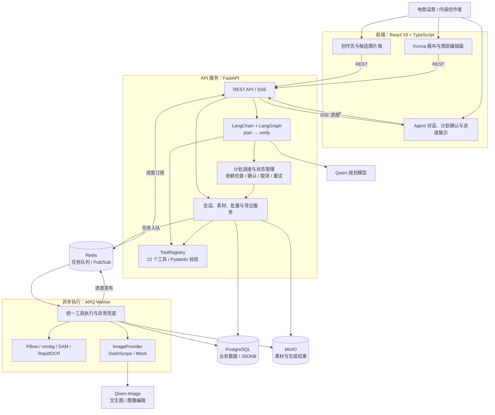

# 商绘 EcomPix

> AI Agent 驱动的电商商品图智能编辑平台
>
> 通过一句自然语言指令，完成商品图精修、营销图生成、批量处理与多尺寸物料交付。

商绘 EcomPix 是一个面向电商内容生产场景的全栈 AI 应用。项目将文本规划模型、图像生成与编辑模型、智能选区和专业画布结合，把用户的修图需求转换为**可校验、可确认、可追踪**的多步工具执行计划。

项目不是简单调用一次大模型接口，而是围绕 **Agent 工具治理、多步任务调度、人机协作、异步执行和实时进度反馈**构建完整业务闭环。

## 核心亮点

- **自然语言驱动修图**：基于 LangChain、LangGraph 和 Tool Calling，将“去背景后调亮，再生成一张场景图”等需求转换为结构化工具计划。
- **可控的 Agent 执行链路**：模型计划必须经过工具白名单、Pydantic 参数校验、依赖补全和循环检测；多步计划经用户确认后执行，支持取消后续与失败步骤重试。
- **统一工具体系**：手动编辑与 Agent 共用 ToolRegistry，当前注册 22 个工具；同一份参数 Schema 同时用于模型函数签名和服务端校验，避免两套规则漂移。
- **电商场景闭环**：覆盖商品主图、场景氛围图、模特展示图、促销海报，以及批量抠图、换背景、调色、超分、扩图和投放尺寸适配。
- **多模态精细编辑**：结合 SAM、rembg、RapidOCR 和图像编辑模型，支持点选或涂抹选区、局部消除与替换，以及主体、背景和文字层拆分。
- **完整工程链路**：采用 FastAPI、ARQ Worker、Redis Pub/Sub、SSE、PostgreSQL JSONB 和 MinIO，实现长任务异步化、状态持久化、进度推送与结果存储。

## 功能模块

| 功能模块 | 已实现能力 |
| --- | --- |
| AI Agent 修图 | 当前指令与画布摘要注入、Tool Calling、最多 8 步计划、服务端二次校验、依赖调度 |
| 人机协作 | 多步计划确认、取消未开始或排队步骤、失败步骤重试、历史计划与状态查询 |
| 电商营销图 | 商品主图、场景氛围图、模特展示图、促销海报，支持 1—4 张候选图 |
| 批量图片处理 | 单批最多 20 张，支持去背景、换背景、调色、超分、扩图、尺寸适配 6 类操作 |
| 物料适配与导出 | 默认输出 1:1、4:5、9:16 投放尺寸，支持 PNG/JPG 和批量 ZIP 导出 |
| AI 文生图 | 提示词与参考图输入、多候选图、生成进度展示、候选图进入编辑器继续处理 |
| 商品图精修 | 去背景、换背景、AI 扩图、超分辨率、11 项调色参数、局部消除与局部替换 |
| 智能选区 | SAM 点选、笔刷涂抹、选区与图层交集计算、画布修订号失效检查 |
| 图层系统 | 主体/背景/文字层拆分、选区物体提升为独立图层、图层移动/缩放/旋转/排序 |
| 画布编辑器 | 缩放平移、裁剪翻转、文字编辑、透明度与可见性控制、撤销重做、前后对比 |
| 任务与素材管理 | 异步任务状态、实时进度、失败信息、图片墙、素材签名 URL、生成结果持久化 |
| 测试与评测 | Mock Provider、Pytest 核心链路测试，以及 MAE、PSNR、Alpha-IoU 等图像指标评测 |

## 系统架构

项目采用**前后端分离、API 与 Worker 分离、同步与异步工具分类执行**的架构。



**架构边界：** 当前是单规划 Agent。LangGraph 负责 `plan → verify`，工具执行与后续步骤推进由服务端调度服务和 ARQ Worker 完成；项目未使用多 Agent、RAG 或模型微调。

### Agent 核心执行流程

1. **组装上下文**：提取当前画幅、图层、选区、透明通道和画布修订号，只向规划模型提供决策所需信息。
2. **生成计划**：规划模型基于绑定的工具函数生成 Tool Calling，LangGraph 将计划送入校验节点。
3. **服务端校验**：检查工具白名单和 Pydantic 参数，限制最多 8 步，并补全步骤 ID、顺序依赖，拒绝缺失依赖和循环依赖。
4. **用户确认**：单步计划直接执行，多步计划先展示步骤并等待用户确认；执行过程中可取消后续，失败后可重试失败步骤。
5. **分类执行**：画布文档操作同步完成，像素处理和模型调用进入 ARQ Worker；每次工具执行都有独立 run_id、状态和进度记录。
6. **反馈与推进**：结果写入 PostgreSQL 和 MinIO，进度通过 Redis Pub/Sub 与 SSE 推送到前端；前序步骤成功后继续调度后续依赖步骤。

## 技术选型

| 技术方向 | 主要技术 | 选型目的 |
| --- | --- | --- |
| 前端应用 | React 19、TypeScript、Vite | 构建类型安全的单页应用与组件化编辑界面 |
| 画布与交互 | Konva、react-konva、Zustand | 支持图层、选区、变换和复杂画布状态管理 |
| 服务端数据请求 | TanStack Query、REST、SSE | 管理服务端快照、缓存失效和实时任务进度 |
| API 与数据校验 | Python 3.13、FastAPI、Pydantic | 提供异步 REST/SSE 接口，统一请求、响应与工具参数校验 |
| Agent 编排 | LangChain、LangGraph、Tool Calling | 绑定规划模型与工具，显式组织 plan/verify 状态流 |
| 文本与图像模型 | Qwen、Qwen-Image、阿里云百炼 | 支持中文指令规划、文生图和图像编辑 |
| 图像与视觉模型 | Pillow、SAM、rembg、RapidOCR、ONNX Runtime | 完成确定性像素处理、智能选区、抠图和文字识别 |
| 异步任务 | ARQ、Redis、Redis Pub/Sub | 解耦耗时工具执行，传递任务并发布实时进度 |
| 数据与对象存储 | PostgreSQL、SQLAlchemy、Alembic、JSONB、MinIO | 持久化业务数据、计划与图层文档，保存图片素材和结果 |
| 测试与评测 | Pytest、Mock Provider、MAE、PSNR、Alpha-IoU | 隔离第三方模型调用，验证核心流程和确定性图像工具 |
| 部署 | Docker、Docker Compose、多阶段构建 | 统一中间件与应用环境，前端构建后由 FastAPI 同源托管 |

### 关键设计说明

- **ToolRegistry**：`ToolSpec` 同时描述工具名称、说明、参数模型、执行器、是否异步及模型隐藏参数。新增工具只需注册一次，即可提供给手动编辑和 Agent。
- **计划与执行分离**：模型只负责生成计划，不直接获得数据库或画布写权限；所有工具都经过统一执行外壳，集中处理状态流转、异常兜底和结果落库。
- **状态持久化**：Agent 计划和工具运行记录使用 JSONB 保存，前端结合快照接口与 SSE 恢复进度，避免仅依赖内存状态。
- **模型适配层**：图像模型通过 `ImageProvider` 抽象接入，真实 DashScope 与本地 Mock 可配置切换，降低业务代码与单一模型平台的耦合。
- **SAM 计算复用**：按图片内容哈希缓存 Embedding，使用容量为 4 的 LRU 缓存；同图后续点选复用编码结果，主要执行解码过程。

## 我们的思考与设计取舍

### 1. 电商修图首先要“保住商品”，其次才是“生成得好”

我们理解的电商图片编辑，不是单纯追求生成画面的新鲜感，而是要尽量保持商品主体、材质、颜色和细节一致，同时提升素材生产效率。因此，营销图和候选结果先进入图片墙，不直接覆盖当前画布，由用户决定是否采用；局部编辑通过“图层×选区”限定作用范围，尽量保持未选中区域不变。相比“一键生成一张图”，我们更关注用户能否安全地尝试、比较、撤销和继续精修。

### 2. 大模型负责理解与规划，确定性程序负责确定性工作

旋转、翻转、调色、尺寸适配等规则明确的操作，不需要每次都交给生成模型；背景创作、局部替换等开放性任务，才使用图像生成与编辑模型。我们把大模型放在需求理解和工具规划层，把具体执行交给可测试的工具函数。这样既发挥模型的语义理解能力，也避免用高成本、非确定性的生成过程替代本可稳定完成的程序逻辑。

### 3. 现阶段“可控执行”比“复杂 Agent 编排”更重要

模型生成的计划不应直接获得画布和数据写入能力，所以我们先做了工具白名单、参数校验、依赖检查、多步确认、失败重试和状态持久化。当前采用单规划 Agent 的 `plan → verify` 链路，是因为它已经覆盖本项目的核心问题，结构更清晰，也更容易定位是规划错误、参数错误还是工具执行失败。我们不会为了展示技术名词而引入多 Agent；只有在真实任务集证明单 Agent 无法稳定承载后，才有理由增加更复杂的路由和协作机制。

### 4. 自然语言不会替代专业画布，两者应当互补

一句话适合表达“去背景、换场景，再输出三个投放尺寸”这样的任务组合，但精确调整位置、选区和图层仍然需要手动交互。因此，Agent 与手动工具共用同一套 ToolRegistry，而不是做两套彼此割裂的编辑能力。选区和图层被设计为两个独立维度，由服务端把当轮选区固定到相关步骤，并通过画布修订号识别失效选区，避免多步执行时模型拿旧状态修改新画布。

### 5. AI 应用的工程价值，体现在模型之外

真实模型调用可能耗时、超时、失败或重复投递，生成结果 URL 也有有效期。基于这些约束，我们引入 ARQ Worker 隔离长任务，使用 PostgreSQL 保存计划与运行状态，通过 Redis Pub/Sub 和 SSE 反馈阶段与错误，并将结果及时转存 MinIO。Provider 抽象和 Mock 则用于降低平台耦合及测试成本。我们认为，进度可见、失败可查、结果可恢复，与模型生成效果同样属于 AI 应用的核心能力。

### 6. 对当前不足的认识与迭代顺序

我们不把当前版本包装成已经完成的生产系统，仍有以下边界：

- 当前规划使用本轮指令与画布摘要，尚未把历史对话自动注入模型，上下文指代和多轮任务衔接仍需增强。
- 模型生成的计划默认按顺序依赖执行，目前不是支持复杂条件分支和并行工作流的通用编排引擎。
- 现有指标评测主要覆盖确定性图像工具，尚缺针对 Agent 工具选择、计划成功率、端到端耗时和模型成本的系统评测。
- 当前通过 run_id 绑定队列任务并过滤终态重复消费，但距离严格的故障恢复、全链路观测和生产级任务治理仍有完善空间。

下一步应优先沉淀真实电商指令与失败案例，建立可重复运行的 Agent 评测集，先量化工具选择准确率、计划完成率和失败类型，再决定是否增加多轮规划、模型路由或更复杂的 Agent 编排。我们的迭代原则是**先找到真实问题，再增加架构复杂度**。

## 项目目录

```text
.
├── backend/
│   ├── app/
│   │   ├── agent/          # LangGraph 规划链路、模型绑定、计划校验与依赖计算
│   │   ├── edits/          # 像素处理、遮罩、SAM、OCR、图层拆分与渲染
│   │   ├── eval/           # 确定性图像工具评测及示例数据集
│   │   ├── models/         # SQLAlchemy 数据模型
│   │   ├── providers/      # DashScope 与 Mock 图像模型适配器
│   │   ├── routers/        # FastAPI REST / SSE 路由
│   │   ├── schemas/        # Pydantic 请求与响应模型
│   │   ├── services/       # Agent、会话、任务、素材、批量与导出业务逻辑
│   │   ├── tasks/          # ARQ Worker 任务入口
│   │   ├── tools/          # ToolSpec 与 22 个工具注册
│   │   ├── events.py       # Redis Pub/Sub 进度事件
│   │   ├── queue.py        # ARQ 队列与任务 ID 管理
│   │   └── worker.py       # Worker 配置
│   ├── migrations/         # Alembic 数据库迁移
│   └── tests/              # 后端自动化测试
├── frontend/
│   └── src/
│       ├── api/            # REST API 封装
│       ├── components/     # 创作页、编辑器与 Agent 交互组件
│       ├── hooks/          # 任务进度、Agent、画布与选区逻辑
│       ├── pages/          # 应用页面
│       └── stores/         # 前端状态管理
├── docker-compose.yml      # PostgreSQL、Redis、MinIO 与部署服务
├── Dockerfile              # 前端构建 + Python 运行环境的多阶段镜像
└── .env.example            # 环境配置示例，不包含真实密钥
```

## 快速开始

### 1. 环境要求

- Docker 20+，包含 Docker Compose
- Python 3.13+
- Node.js 18+，推荐 Node.js 20/22
- [uv](https://docs.astral.sh/uv/) Python 包管理工具
- 如需真实模型能力，需要[阿里云百炼 API Key](https://bailian.console.aliyun.com/)

将代码下载到本地后，进入项目根目录。

### 2. 配置环境变量

```bash
cp .env.example .env
```

Windows PowerShell：

```powershell
Copy-Item .env.example .env
```

图像模型支持两种模式：

| 模式 | 配置 | 说明 |
| --- | --- | --- |
| 本地 Mock | `IMAGE_PROVIDER=mock` | 使用本地占位图，不消耗图像模型调用额度，便于开发界面和任务链路 |
| 真实图像模型 | `IMAGE_PROVIDER=dashscope` | 调用阿里云百炼文生图与图像编辑模型，需要配置 `DASHSCOPE_API_KEY` |

> 注意：Mock 只替代图像生成与编辑模型。自然语言 Agent 的规划模型仍需要 `DASHSCOPE_API_KEY`；未配置时，手动编辑功能仍可使用，但 Agent 指令会明确返回规划模型不可用。

首次使用 rembg 或 SAM 时可能需要下载模型文件，请保证网络可用并预留足够磁盘空间。

### 3. 启动中间件

```bash
docker compose up -d
```

默认启动 PostgreSQL、Redis 和 MinIO，不会启动部署 profile 中的应用服务。

### 4. 安装并启动后端

```bash
cd backend
uv sync --all-extras --python 3.13
uv run alembic upgrade head
```

终端一：启动 API 服务。

```bash
uv run uvicorn app.main:app --reload --host 0.0.0.0 --port 7302
```

终端二：启动异步 Worker。

```bash
cd backend
uv run arq app.worker.WorkerSettings
```

可用地址：

- 健康检查：<http://localhost:7302/api/health>
- API 文档：<http://localhost:7302/api/docs>

### 5. 安装并启动前端

新开终端，在项目根目录执行：

```bash
cd frontend
npm install
npm run dev
```

访问 <http://localhost:7301>。

### 6. 运行测试与图像工具评测

```bash
cd backend
uv run pytest
uv run python -m app.eval app/eval/dataset
```

测试通过 Mock 和 Fake Planner 隔离真实大模型及第三方接口调用，不消耗模型 API 额度。图像评测面向确定性工具，指标包括 MAE、PSNR、Alpha-IoU、主体完整度和尺寸一致性，不代表 Agent 规划准确率。

## Docker 部署

`Dockerfile` 使用多阶段构建：先编译前端，再将静态产物放入 Python 运行镜像，由 FastAPI 同源托管。

1. 在项目根目录创建 `.env`，生产环境务必使用随机强密钥替换 `JWT_SECRET`，并检查数据库、对象存储和模型配置。
2. 将 `docker-compose.yml` 中 `app` 与 `worker` 服务的 `S3_PUBLIC_ENDPOINT` 设置为浏览器能够访问的对象存储地址，例如 `http://服务器公网IP:7313`。Compose 中的 `environment` 会覆盖 `.env`，不能只修改 `.env`。
3. 根据网络环境开放应用端口 `7302` 和对象存储端口 `7313`，并限制数据库、Redis 与 MinIO 控制台端口的公网访问。
4. 构建并启动服务：

```bash
docker compose --profile deploy up -d --build
docker compose --profile deploy exec app alembic upgrade head
```

访问 `http://服务器地址:7302`。

> 不要将包含真实密钥的 `.env` 文件提交到代码仓库。生产部署还应配置 HTTPS、域名、备份和日志监控。
